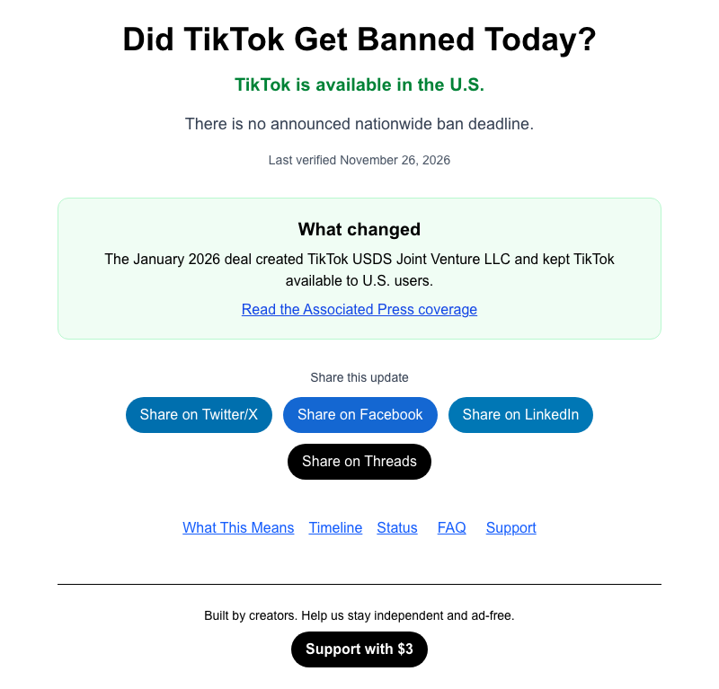
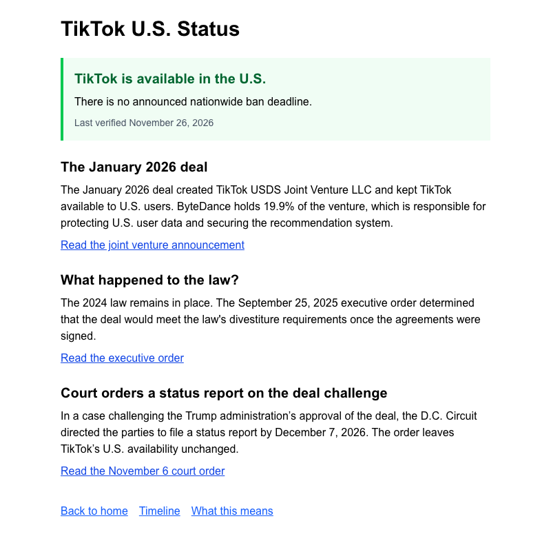
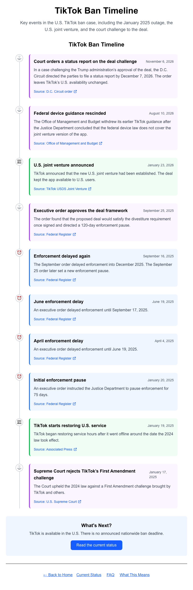

# Did TikTok Get Banned?

The site tracks TikTok’s availability in the United States and explains the history of the 2024 law, the brief January 2025 outage, the January 2026 U.S. joint venture, and the court challenge to the deal.

## Current screenshots

Captured from the live site on November 27, 2026.







- [Live site](https://didtiktokgetbanned.com/)
- [GitHub Pages mirror](https://rodneyg.github.io/tiktok-ban-site/)
- [Current status](https://didtiktokgetbanned.com/status)
- [Timeline](https://didtiktokgetbanned.com/timeline)

The GitHub Pages mirror serves the site pages as a static export. Use the main site for the countdown API.

## Local development

This site uses Next.js (Pages Router) and Tailwind CSS.

```bash
npm ci
npm run dev
```

Run `npm run lint` and `npm run build` separately to check changes. After the build, run `node --test` to check the countdown API.

The shared status summary, verification date, and source URLs live in [`utils/tiktokStatus.ts`](utils/tiktokStatus.ts). The status page and timeline add their own explanations in [`pages/status.tsx`](pages/status.tsx) and [`pages/components/NewsTimeline.tsx`](pages/components/NewsTimeline.tsx).

See the [changelog](CHANGELOG.md) for site updates.

## Countdown API

`GET /api/countdown` on the main site remains available for integrations. It reports the last verified status. When there is no announced nationwide ban deadline, the response has HTTP status 200, marks the deadline as inactive, and sets the countdown fields to null.

```json
{
  "status": "inactive",
  "deadline": null,
  "timeRemaining": null,
  "progress": {
    "percentage": null,
    "description": "There is no announced nationwide ban deadline."
  },
  "lastUpdated": "2026-11-26",
  "nextDeadline": null
}
```

`lastUpdated` records the most recent status verification date and can change after this example.

## About

Built by [@rodneyg](https://github.com/rodneyg). The site is independent of TikTok, ByteDance, and any government entity.

[Support the site on Ko-fi](https://ko-fi.com/rg2official)
